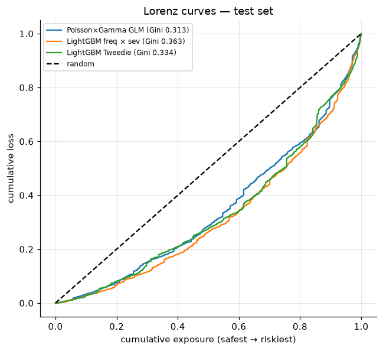
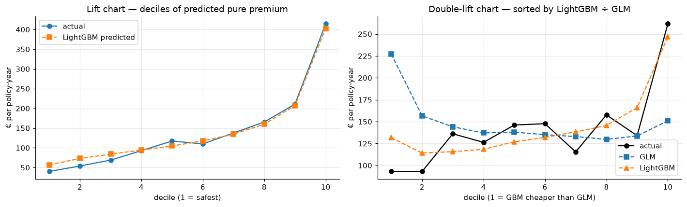
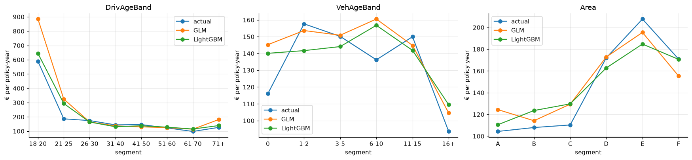
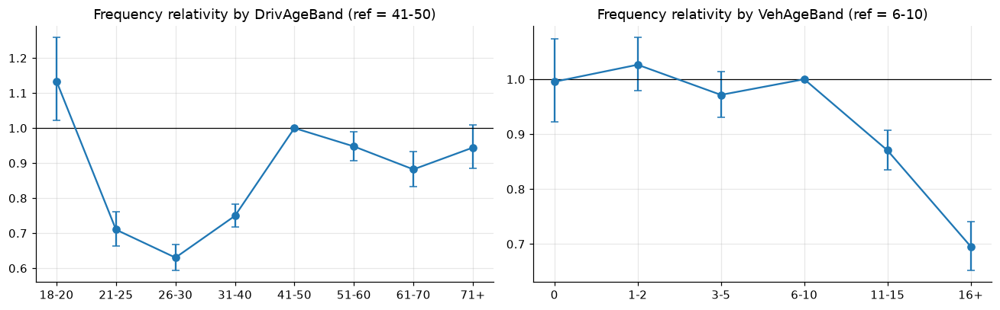
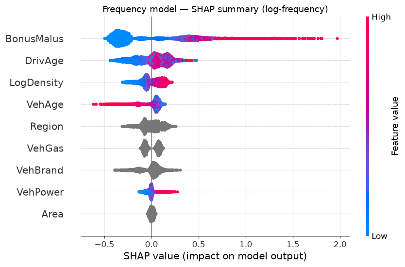

# Motor Insurance Pricing: GLM vs Gradient Boosting

End-to-end pricing workflow on the freMTPL2 French motor portfolio (678,013 policies): exposure-aware Poisson/Gamma GLMs as the actuarial benchmark, LightGBM challengers with a monotonic constraint, insurance-style evaluation (Gini, lift, double-lift), SHAP explainability, MLflow tracking and a FastAPI quote service. Runs on a MacBook M2 with 8 GB RAM.

**Headline result:** the LightGBM frequency × severity model beats the GLM benchmark on a held-out test set of 101,702 policies: **Gini 0.363 vs 0.313 (+16% relative)** and **1.4% lower Poisson deviance**. It tracks actual losses more closely in the extreme deciles of the double-lift chart.

## Results (test set, never used for tuning)

| Model | Poisson dev. (freq) | Gamma dev. (sev) | Tweedie dev. (pure premium) | Gini |
|---|---|---|---|---|
| Null (portfolio average) | 0.4763 | 1.4122 | 78.93 | 0.012 |
| Poisson × Gamma GLM | 0.4559 | 1.4182 | 75.18 | 0.313 |
| **LightGBM freq × sev** | **0.4495** | **1.4060** | **73.91** | **0.363** |
| LightGBM Tweedie (direct) | n/a | n/a | 74.57 | 0.334 |

Lower deviance and higher Gini are better. Portfolio KPIs: claim frequency 7.37 per policy-year, average severity €1,976, pure premium €145.58 per policy-year.



### Where the models differ
In the double-lift chart (policies sorted by GBM ÷ GLM), the GLM is far off in the extreme deciles: it predicts 2.44× actual loss in the first decile and 0.58× in the last, versus 1.41× and 0.94× for the GBM.



The GLM also over-prices young and very old drivers (test-set pure premium, € per policy-year):

| Driver age | Actual | GLM |
|---|---|---|
| 18-20 | 589 | 885 |
| 21-25 | 186 | 324 |
| 71+ | 126 | 181 |



### Findings and caveats
* **Frequency is where the gain is.** Severity is weakly predictable: the GLM severity model scores slightly worse than the null on test (1.4182 vs 1.4122), consistent with a high dispersion of 12.9 and only 17,460 claim rows for training. The regularised GBM severity model (33 trees, 5 leaves) edges ahead (1.4060).
* **Two-part beats direct Tweedie** here (Gini 0.363 vs 0.334). Tweedie power was fixed at 1.5, not tuned.
* **Differences are small in deviance terms.** Treat the Gini and calibration evidence as more informative than the 1-2% deviance gaps; no confidence intervals are reported.
* **Data limits:** French MTPL data, no dates (stratified random split, no out-of-time test), claims capped at €200k per policy.

## Data quality finding
The OpenML copy of freMTPL2 stores categorical values with literal quote characters (`'Diesel'`, `'Regular'`). The pandera schema caught this on load, and `build_dataset()` now strips them. See `src/motor_pricing/data.py` and `tests/test_data.py`.

## Method
| Component | Model | Target / weight |
|---|---|---|
| Frequency | Poisson GLM (offset log exposure); LightGBM `poisson` | claim count; GBM: claims ÷ exposure weighted by exposure |
| Severity | Gamma GLM; LightGBM `gamma` | average cost per claim, claims only, weighted by claim count |
| Pure premium | frequency × severity; LightGBM `tweedie` (p = 1.5) | loss ÷ exposure |

* 70/15/15 stratified train/validation/test split; test set used once.
* `BonusMalus` monotone-constrained in the GBM so a worse claims record never lowers frequency.
* Optuna tuning (30 trials frequency, 20 severity) with early stopping on validation; all runs logged to MLflow.
* GLM balance check passes: predicted train claims 18,459 = actual 18,459.




## Quick start (macOS, Apple Silicon)
```bash
git clone https://github.com/<your-username>/motor-insurance-pricing.git motor-pricing && cd motor-pricing
brew install libomp uv
uv sync --extra dev
uv run python -m ipykernel install --user --name motor-pricing
MOTOR_PRICING_SYNTHETIC=1 uv run pytest   # offline tests
uv run jupyter lab                        # run notebooks 01 → 04 in order
```
First run downloads freMTPL2 from OpenML (internet required) and caches it in `data/`.

Serve quotes with `make train && make api`, browse experiments with `make mlflow`.

## Notebooks
1. `01_eda_and_data_quality`: load, clean, validate, KPIs, one-way risk drivers, split
2. `02_glm_baselines`: Poisson and Gamma GLMs, relativities, balance check
3. `03_lightgbm_challengers`: Poisson/Gamma/Tweedie GBMs, Optuna, MLflow
4. `04_evaluation_and_explainability`: Gini, lift, double-lift, calibration, SHAP, governance notes

## Governance notes (UK/EU context)
A technical price is not a customer price: expenses, margin and the FCA renewal price-walking rules (ICOBS 6B) sit downstream. Sex is not a permitted rating factor in the UK/EU, and region or density can act as proxies and need review. This repo is a methodology demonstration, not a rate filing.

## Limitations and next steps
* French data, no dates, claims truncated at €200k.
* Add bootstrap confidence intervals on Gini and deviance differences.
* Model large losses separately; add PSI-based drift monitoring and a model card.
* Move data prep into dbt + DuckDB for an analytics-engineering layer.

## Data credit
freMTPL2freq / freMTPL2sev from the CASdatasets R package (Dutang & Charpentier), distributed via OpenML. The data is downloaded at run time, not redistributed.
